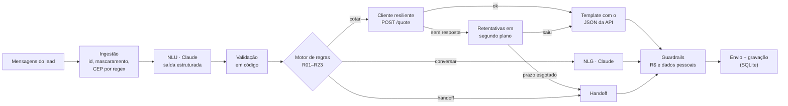

# AutoSeguro: agente de cotação de seguro auto

Agente que atende leads da seguradora fictícia AutoSeguro no WhatsApp: conversa, coleta os
dados, cota pela API de cotação (instável de propósito) e decide quando resolve sozinho e
quando passa para um humano. Resposta ao [desafio técnico FDE da Namastex](docs/DESAFIO.md).

**Ideia central: o LLM conversa, o código decide.** O Claude entende e escreve as mensagens;
quando cotar, que preço mostrar e quando chamar um humano são decisões de código
determinístico, testado e rastreável.

- **Nunca inventa preço.** Mensagem com preço é montada a partir do JSON da API, e todo valor
  em R$ que sai é conferido contra as cotações da conversa.
- **Aguenta a API instável.** Com a taxa de falha padrão (20% de erro + 10% de lentidão), 98%
  das cotações saem na hora; o resto é retentado em segundo plano e entregue sozinho. Se a API
  cair de vez, o lead recebe um aviso honesto e, passado o prazo, um humano.
- **Critério de handoff explícito:** 9 motivos, cada um com prioridade, regra de origem e um
  resumo (sem dados pessoais) para o humano.
- **Tudo rastreável:** cada mensagem, decisão, cotação e tentativa na API tem id e status.
- **O LLM nunca vê dados pessoais:** CPF, telefone, e-mail, placa, nome e CEP são mascarados
  antes de qualquer chamada.

> **Log de uma execução completa:** [`runs/01_caminho_feliz/`](runs/01_caminho_feliz/)
> ([conversa](runs/01_caminho_feliz/transcript.md) e [rastro](runs/01_caminho_feliz/trace.txt)).
> Nessa execução, uma chamada à API recebeu HTTP 500 e outra travou; as duas foram
> retentadas e o lead recebeu os três preços sem perceber nada.

## Onde olhar cada critério da avaliação

| Critério | Onde ver |
|---|---|
| Funciona de ponta a ponta? | [`runs/01_caminho_feliz`](runs/01_caminho_feliz/transcript.md): conversa → dados → 3 cotações → dúvida → fechamento |
| O que faz quando a `/quote` falha? | [Falhas da API](#o-que-o-agente-faz-quando-a-quote-falha), [benchmark](docs/benchmark-cotacao.md), [`runs/02`](runs/02_api_fora_do_ar/transcript.md) (queda total) e [`runs/03`](runs/03_api_cai_e_volta/transcript.md) (cai e volta) |
| Critério de handoff explícito e defensável? | [Política de handoff](#política-de-handoff) e `src/autoseguro/agent/policy.py` |
| Dá pra rastrear o que aconteceu? | `trace.txt` de cada cenário em [`runs/`](runs/) e `uv run autoseguro trace <id>` |
| Cuidado com dados sensíveis? | [Dados sensíveis](#dados-sensíveis-lgpd), [achados do dataset](docs/achados-dataset.md) |
| Outro engenheiro entende as decisões? | [Decisões](#decisões-e-por-quê) e docstrings de cada módulo |
| Como a IA foi usada? | [Uso de IA](#uso-de-ia) e [`ai-logs/`](ai-logs/) |

## Como rodar

Pré-requisitos: [uv](https://docs.astral.sh/uv/) (Python 3.12 é instalado por ele) e uma chave
da Anthropic. Docker é opcional.

```bash
cp .env.example .env    # preencha ANTHROPIC_API_KEY (e ANTHROPIC_WORKSPACE_ID, se a chave pedir)
uv sync
```

**Conversar com o agente pelo terminal** (o WhatsApp é simulado pelo chat):

```bash
uv run autoseguro chat --spawn-api      # sobe uma instância local da API e abre o chat
```

Dentro do chat: cada linha é uma mensagem; `||` separa uma rajada de mensagens (um turno);
`[audio] ...` simula mídia; `/trace` mostra o rastro; `/sair` encerra.

**Com Docker:**

```bash
docker compose up -d                     # API de cotação em http://localhost:8000 (como no enunciado)
docker compose run --rm agent            # chat com o agente, falando com a API do compose
```

**Comandos:**

| Comando | O que faz |
|---|---|
| `uv run autoseguro chat` | Chat com o agente (`--spawn-api` ou `QUOTE_API_URL`) |
| `uv run autoseguro run-scenario scenarios/*.toml` | Roda os 7 cenários de ponta a ponta e grava os logs em `runs/` |
| `uv run autoseguro trace <conversation_id>` | Rastro completo de uma conversa |
| `uv run autoseguro conversations` | Lista as conversas gravadas |
| `uv run autoseguro bench` | Benchmark do cliente resiliente × cliente ingênuo, com a API real |
| `uv run autoseguro data silver` | Dataset: Bronze → Silver (ordena, mascara, estrutura) |
| `uv run autoseguro data audit` | Dataset: recota o histórico na API e gera `docs/achados-dataset.md` |
| `uv run pytest` | 77 testes (os de integração sobem a API sozinhos; nenhum chama o LLM) |

Configuração por variável de ambiente (ver [`.env.example`](.env.example)): modelo e esforço
do LLM (`ANTHROPIC_MODEL`, padrão `claude-sonnet-5-5`; `ANTHROPIC_EFFORT`, padrão `low`),
URL da API, agenda das retentativas em segundo plano e a chave de pseudonimização do dataset.

## Como funciona

Um turno = uma rajada de mensagens do lead:



1. **Ingestão** (`agent/orchestrator.py`): cada mensagem ganha um id, é mascarada e gravada
   já mascarada. O CEP é capturado por regex antes do mascaramento: o LLM nunca o vê.
2. **NLU** (`agent/nlu.py`): o Claude devolve, em JSON validado por esquema, os dados citados
   (idade, ano do carro, plano, data de início) e as intenções (pedir humano, objeção de preço,
   querer fechar, dúvida...). O código confere faixas e datas e descarta o que for implausível.
3. **Motor de regras** (`agent/policy.py`): Python puro. Regras em ordem; a primeira que casa
   decide o turno, e o id dela (R01...R23) vai para o rastro.
4. **Ação:** cotar (planos em paralelo), apresentar cotação (template), escrever a resposta
   (Claude, a partir de uma instrução específica da regra) ou passar para um humano.
5. **Guardrails** (`agent/guardrails.py`): toda mensagem que sai, de template ou do LLM, passa
   pela conferência de valores e de dados pessoais. Depois, é gravada e enviada.

## Decisões (e por quê)

### 1. O LLM conversa, o código decide

A alternativa óbvia seria um agente com ferramentas (`cotar`, `transferir`) decidindo tudo
sozinho. Para este problema, os pontos avaliados (preço certo, falha da API, critério de
handoff, rastreabilidade) são exatamente os que menos devem depender de um modelo. Então:

- o LLM faz duas coisas: **entender** (extração estruturada) e **escrever** (mensagens de
  conversa, a partir de uma instrução da regra que disparou);
- o código faz o resto: valida os dados, decide o próximo passo, chama a API, monta
  mensagens com preço e decide o handoff;
- cada chamada ao LLM é **sem estado**: o prompt é reconstruído a partir do estado da conversa,
  sem reenviar turnos do assistente. Isso deixa cada decisão reproduzível a partir do que
  estava gravado.

O custo é uma conversa um pouco menos "livre" que a de um agente autônomo. Em troca, as regras
são testadas em unidade (`tests/test_agent.py`, `tests/test_guardrails_policy.py`) e cada
resposta tem uma regra de origem no rastro.

### 2. Preço só sai da API

- Mensagens com preço são **templates** preenchidos com o JSON da `/quote`: mensalidade,
  franquia, coberturas, carência de 30 dias para roubo/furto e o primeiro pagamento
  proporcional quando a vigência começa no meio do mês (os vendedores do histórico nunca
  mencionam carência nem pro-rata).
- O LLM é instruído a não escrever valores. Se escrever, o **guardrail** confere cada valor em
  R$ (e números no formato `219,90`) contra as cotações da conversa e as franquias da tabela.
  Valor sem lastro: a resposta é regerada uma vez com instrução mais dura e, se insistir, é
  trocada por uma mensagem fixa. Nos 7 cenários gravados o guardrail não precisou bloquear
  nada, mas o teste `test_invented_price_from_llm_is_blocked` mostra que bloqueia.
- A tabela de `GET /planos` é usada para descrever planos (coberturas, franquia), nunca para
  calcular preço.

### 3. O que o agente faz quando a `/quote` falha

A API falha em ~20% das chamadas (500/502/503) e trava 8 segundos em ~10%, depois responde.
O tratamento é em camadas (`quote/`):

| Camada | O quê | Por quê |
|---|---|---|
| Validação antes de chamar | CEP com 8 dígitos obrigatório, plano explícito, data ≥ hoje | A API aceita entradas que geram preço errado sem erro (ver abaixo) |
| Timeout curto | 2,5 s por tentativa | Chamada saudável responde em milissegundos; esperar os 8 s é pior que tentar de novo |
| Retentativa seletiva | Só 5xx, 429, timeout, erro de conexão e corpo corrompido; até 4 tentativas, backoff exponencial com jitter, prazo total de 12 s | 4xx é resposta (recusa ou payload ruim), não falha |
| Duas respostas 422 diferentes | `cotacao_recusada` (negócio) × `detail` do FastAPI (validação) | Recusa vira handoff `inelegivel`; validação é bug nosso e vira `erro_interno` |
| Circuit breaker | Abre se ≥90% das últimas 30 chamadas falharem (mínimo 10); meia-abertura após 15 s | Calibrado para a taxa normal da API: falhas comuns nunca abrem; queda real abre em 10 chamadas e para de martelar o legado |
| Cache | Mesmo payload no mesmo dia não chama a API | A cotação é função pura do payload e da data |
| Segundo plano | Rodadas após 10, 20, 40, 80 e 120 s (~4,5 min) | O lead recebe aviso honesto e o preço chega sozinho quando sair |
| Prazo esgotado | Handoff `cotacao_indisponivel`, prioridade alta | Nunca inventar preço nem deixar o lead sem resposta |

Benchmark contra a API real, 200 cotações por linha ([`docs/benchmark-cotacao.md`](docs/benchmark-cotacao.md)):

| Taxa de falha | Cliente | Com preço | Espera p95 |
|---|---|---|---|
| 20% (padrão) | resiliente | **98,0%** | 3,0 s |
| 20% (padrão) | ingênuo (1 chamada, timeout 30 s) | 81,5% | 8,0 s |
| 50% | resiliente | **91,5%** | 3,4 s |
| 50% | ingênuo | 48,5% | 8,0 s |
| 100% | resiliente | 0%, com só 10 chamadas à API (breaker aberto) | 0,3 s |

Os ~2% que não saem na hora entram nas rodadas em segundo plano: na auditoria do dataset,
22 de 2.500 cotações falharam na primeira passada e todas saíram nas rodadas seguintes.

Duas descobertas durante o desenvolvimento estão registradas no código: o primeiro breaker
abria após 5 falhas *seguidas*, o que com 30% de falha normal acontece toda hora e travaria
todas as cotações (virou taxa sobre janela); e a data "de hoje" vinha do relógio do processo,
que num container em UTC já é amanhã às 21h de Brasília (virou um relógio de negócio em
`America/Sao_Paulo`, com teste de regressão).

**O que a API faz errado em silêncio** (e como o agente contorna, sem alterar o legado):

| Comportamento da API | Efeito | Contorno |
|---|---|---|
| `cep` é opcional | Sem CEP, o agravo de 30% da região de risco não é aplicado; 36% dos leads do dataset estão nessas regiões | CEP obrigatório antes de cotar |
| Região = 2 primeiros caracteres da string | `"CEP 07123-456"` ou CEP sem o zero à esquerda caem na região errada | CEP normalizado para `NNNNN-NNN` |
| `plano_id` padrão é `essencial` | Cotação de um plano que o lead não pediu | Plano sempre explícito |
| `data_inicio` no passado é aceita | Pro-rata calculado para um mês que já passou | Data validada (≥ hoje, no fuso de Brasília) |
| Idade do veículo = ano atual − ano | Carro ano-modelo 2027 comprado em 2026 é recusado como "fora das faixas" | Tratado como lacuna da regra: handoff para humano |

### 4. Política de handoff

Regras em `agent/policy.py`, na ordem em que são avaliadas. Cada handoff grava motivo,
prioridade, regra, detalhe e um resumo para o humano (dados da cotação com CEP truncado,
cotações feitas, últimas mensagens mascaradas). Depois do handoff o agente para de responder:
a próxima mensagem do lead recebe um único aviso e as seguintes, silêncio.

| Motivo | Prioridade | Gatilho | Por quê |
|---|---|---|---|
| `pedido_humano` (R01) | normal | Lead pede uma pessoa | Sempre atendido, em qualquer etapa |
| `atrito` (R02) | alta | Reclamação, irritação, ameaça | Exige julgamento humano |
| `fora_de_escopo` (R03) | normal | Sinistro, cancelamento, outro produto, carro de aplicativo | Não é papel do agente improvisar |
| `fechamento` (R04) | alta | Quer fechar ou manda documento depois da cotação | Emissão exige CPF, documentos e pagamento; lead quente |
| `negociacao` (R07) | normal | Objeção de preço/franquia/concorrente depois de 1 alternativa (R06), ou sem alternativa possível | O agente não tem alçada de desconto; ~52% das conversas do histórico terminam em objeção |
| `inelegivel` (R15) | normal | Regra recusa o perfil (idade fora de 18–75, carro com mais de 20 anos), depois de confirmar o dado | Ver decisão 5 |
| `cotacao_indisponivel` (R23) | alta | API não respondeu nem nas rodadas em segundo plano | Nunca inventar preço |
| `sem_progresso` (R10, R17) | baixa | 3 turnos sem informação nova, ou mídia ilegível repetida | Evitar loop |
| `erro_interno` (R00) | alta | LLM fora do ar ao interpretar, payload rejeitado, erro inesperado | O lead nunca fica sem resposta |

O agente **resolve sozinho**: coleta de dados, cotação dos planos, explicação de coberturas,
franquia, carência e pagamento, comparação e recotação, uma alternativa de plano diante de
objeção (mais barato para preço, franquia menor para franquia), "vou pensar" (guarda a
cotação, sem handoff) e desistência (encerra com educação).

### 5. Leads inelegíveis vão para um humano

As regras recusam 30% dos leads do dataset (idade acima de 75 ou carro com mais de 20 anos).
Mesmo assim, os vendedores fecharam 27% deles, quase a mesma taxa dos elegíveis (29%).
Tratando o histórico como fonte da verdade, o time humano tem como cotar esses casos e a API
não. Por isso o agente:

1. detecta a inelegibilidade assim que sabe idade e ano do carro (tabela de `GET /planos`;
   a pré-checagem concordou com a API em 2.500 de 2.500 casos do dataset);
2. confirma o dado uma vez (um "76" pode ser um "67" digitado errado);
3. coleta o que falta para o especialista e encaminha, sem chamar a `/quote`, sem mostrar
   preço e sem linguagem de recusa.

Ver [`runs/04_lead_inelegivel`](runs/04_lead_inelegivel/transcript.md).

### 6. Dados sensíveis (LGPD)

- **Minimização:** a cotação só precisa de idade, ano do carro e CEP. O agente nunca pede CPF,
  e-mail, placa nem documentos (os vendedores do histórico pedem CPF em 100% das conversas).
  Quando o lead manda por conta própria, o agente avisa que não precisa.
- **Mascaramento na entrada** (`privacy/redact.py`): CPF (com dígito verificador, para não
  confundir com telefone), telefone, e-mail, placa (antiga e Mercosul), CEP e o nome do perfil
  são trocados por marcadores antes do LLM, do banco e dos logs. Um teste garante que nenhum
  prompt contém esses dados.
- **O que fica guardado:** mensagens só mascaradas; pedidos de cotação com o CEP truncado
  (`01310-***`); o CEP completo só no estado operacional da conversa, porque é preciso para
  recotar. Os logs JSON não têm texto de mensagem, só ids e métricas.
- **Na saída:** o guardrail mascara qualquer dado pessoal que o LLM tente escrever.
- **Dataset:** a camada Silver troca CPF, e-mail, telefone, placa e nome por pseudônimos
  (HMAC com chave: o mesmo CPF vira o mesmo token, sem como reverter sem a chave) e reduz o CEP
  aos 2 dígitos que a regra de preço usa. O nome do lead também aparece na saudação do
  vendedor, então o mascaramento cobre as mensagens dos dois lados. Depois do mascaramento:
  0 mensagens com dado pessoal detectável.

Regex em vez de um modelo de NER foi escolha consciente: os formatos são bem definidos, o
comportamento é previsível e testável e nada sai da máquina para ser classificado. A limitação
é o nome: só é detectado o que já se conhece (nome do perfil).

### 7. Rastreabilidade

SQLite com tabelas só de inserção (`store.py`): `messages` (id, direção, tipo, corpo mascarado,
status, origem: template, LLM ou fallback), `quotes` (id, plano, status, prêmio, inline ou em
segundo plano), `quote_attempts` (rodada, tentativa, status HTTP, erro, latência), `handoffs`
(motivo, prioridade, resumo) e `events` (resultado da NLU, regra que decidiu, mudanças de
etapa, bloqueios de guardrail). Os logs JSON (`events.jsonl`) carregam os mesmos ids:
`conversation_id`, `message_id`, `quote_id`, `handoff_id`. A referência da cotação vai na
própria mensagem para o lead (`Ref.: q_...`), então o humano que assume acha a cotação no
rastro.

### 8. O dataset

O dataset tem schema limpo e conteúdo bagunçado. Ele foi usado para entender o problema e
para testar o próprio agente. Não serviu como roteiro nem como fonte de preço.

- **Bronze → Silver** (`data/silver.py`): ordenação por `message_index` (em 2.495 das 2.500
  conversas o timestamp volta no tempo), mascaramento e pseudonimização, e extração de veículo,
  oferta do vendedor, objeção e mídia.
- **Silver → Gold** (`data/audit.py`): cada cotação histórica foi refeita na API oficial,
  usando o próprio cliente resiliente. Resultado: **nenhum** preço de vendedor bate com o
  oficial (mediana 31% abaixo), e 751 leads inelegíveis receberam preço mesmo assim.
- **Como isso moldou o agente:** preço só da API; CEP obrigatório; objeções de
  preço/franquia/concorrente viraram regras com alternativa e handoff; leads inelegíveis viraram
  handoff; mídia sem conteúdo (7% das mensagens) tem tratamento próprio.

Relatório completo: [`docs/achados-dataset.md`](docs/achados-dataset.md).

### 9. Modelo e chamadas ao LLM

- `claude-sonnet-5-5` com esforço `low`: turnos curtos de WhatsApp pedem latência baixa.
  Nos cenários, a NLU levou 1,6 s (mediana) e a escrita 2,0 s. Configurável por
  `ANTHROPIC_MODEL` / `ANTHROPIC_EFFORT`.
- NLU com saída estruturada (JSON Schema); NLG em texto livre com instruções curtas por regra.
- System prompt fixo e em cache: 35 de 36 chamadas dos cenários leram do cache.
- `fallbacks: "default"` ligado: se o modelo recusar por política, a API tenta outro modelo.
- O LLM também é uma dependência que falha: o SDK tenta de novo; se a NLU falhar, handoff
  `erro_interno`; se a escrita falhar, sai uma mensagem fixa e a conversa continua.

### 10. Stack

Python 3.12 com uv, httpx, pydantic, o SDK da Anthropic direto (sem LangChain, para o fluxo de
controle ficar à vista), SQLite (zero infraestrutura) e typer. `quote-service/` não foi
alterado: é o "legado que não é nosso" e todos os contornos estão do lado do cliente. No
`docker-compose.yml` só entraram o healthcheck da API e o serviço do agente.

## Cenários gravados

`uv run autoseguro run-scenario scenarios/*.toml` roda cada cenário contra a API real (subindo
e reiniciando uma instância local quando o cenário pede queda e volta) e o Claude de verdade.
Os resultados estão em [`runs/`](runs/), cada um com `transcript.md`, `trace.txt` e `events.jsonl`.

| Cenário | API | O que acontece | Desfecho |
|---|---|---|---|
| [01 caminho feliz](runs/01_caminho_feliz/transcript.md) | instabilidade padrão | Dados aos poucos, CPF mandado sem pedir (mascarado), 3 cotações (1 erro 500 e 1 timeout retentados), dúvida, fechamento | handoff `fechamento` |
| [02 API fora do ar](runs/02_api_fora_do_ar/transcript.md) | 100% de falha | Aviso honesto, rodadas em segundo plano (breaker: 11 chamadas em vez de 48) | handoff `cotacao_indisponivel` |
| [03 cai e volta](runs/03_api_cai_e_volta/transcript.md) | 100% → 0% | Aviso honesto; quando a API volta, a cotação chega sozinha | cotado, "vou pensar" |
| [04 inelegível](runs/04_lead_inelegivel/transcript.md) | padrão | 78 anos: confirma, coleta o CEP, encaminha sem chamar a API | handoff `inelegivel` |
| [05 objeção](runs/05_objecao_e_negociacao/transcript.md) | padrão | Acha caro → alternativa mais barata cotada → concorrente | handoff `negociacao` |
| [06 mídia e humano](runs/06_midia_e_pedido_humano/transcript.md) | — | Áudio (pede texto), pede pessoa, um aviso e silêncio | handoff `pedido_humano` |
| [07 fora de escopo](runs/07_fora_de_escopo/transcript.md) | — | Quer acionar o seguro após batida | handoff `fora_de_escopo` |

## Estrutura

```
src/autoseguro/
  agent/          state (estado e enums), nlu, policy (regras), messages (templates),
                  guardrails, llm (wrapper do SDK), orchestrator (o turno)
  quote/          client (retry/timeout), breaker, deferred (segundo plano), catalog
                  (GET /planos e elegibilidade), models, bench
  privacy/        redact (detecção e mascaramento de dados pessoais)
  data/           silver (Bronze → Silver), audit (Silver → Gold + relatório)
  channels/       cli_chat, scenarios
  store.py        banco de eventos (SQLite)        trace.py   rastro legível
  clock.py        data de negócio (fuso de Brasília)
scenarios/        conversas roteirizadas (TOML)
runs/             logs das execuções dos cenários
docs/             enunciado, plano, achados do dataset, benchmark
quote-service/    API de cotação fornecida (inalterada)
ai-logs/          sessões com IA exportadas
```

## Limitações e próximos passos

- **Canal real:** o WhatsApp é simulado (chat e cenários). Num webhook de verdade entram
  agrupamento de rajadas por janela de tempo, deduplicação por id da mensagem e templates
  aprovados para mensagens proativas depois da janela de 24 h.
- **Retentativas em segundo plano vivem no processo:** se o agente reiniciar, as cotações
  pendentes se perdem (o estado da conversa não). Em produção, fila durável (SQS, Redis) com
  worker.
- **SQLite e locks em memória** servem para uma instância. Com várias, Postgres e lock por
  conversa.
- **Avaliação do LLM:** os cenários verificam desfechos, não a qualidade do texto. O próximo
  passo é uma avaliação replicando conversas do dataset (as personas da Silver já existem) com
  métricas de extração e de decisão.
- **Mascaramento por regex:** nomes que não são o do perfil passam (ex.: "fala com a Ana").
- **Virada de ano:** a API calcula a idade do veículo com o relógio dela (UTC no container);
  entre 21h e meia-noite do dia 31/12, a pré-checagem e a API podem divergir em um ano. A API
  segue como autoridade: se recusar, vira handoff.
- **Requisição duplicada (hedging)** cortaria a espera da chamada lenta de ~2,5 s para ~1 s;
  ficou de fora porque o retry com timeout já resolve.

## Uso de IA

O projeto foi feito com o **Claude Code** em uma sessão contínua: exploração, plano,
implementação, testes, execução dos cenários e documentação. As conversas exportadas estão em
[`ai-logs/`](ai-logs/) (segredos e dados pessoais do autor removidos por
`scripts/export_ai_logs.py`).

Como o trabalho foi conduzido:

- **Explorar antes de planejar.** Antes de qualquer código, a IA leu a API, o gerador do
  dataset e o parquet, e recalculou as cotações históricas. Os achados (preços inventados,
  leads inelegíveis, CEP opcional, dica da camada Silver no gerador) definiram o plano
  ([`docs/PLAN.md`](docs/PLAN.md)).
- **Decisões de produto ficaram com o autor:** encaminhar leads inelegíveis para humano em vez
  de encerrar (com base no histórico), comprimir o escopo para o prazo real e usar o Sonnet 5.5
  com esforço baixo.
- **Verificar em vez de confiar.** Cada parte foi testada contra a API real antes de seguir:
  benchmark, auditoria de 2.500 cotações, cenário com LLM simulado antes do LLM real, revisão de
  cada conversa gravada. Isso pegou erros da própria IA: o breaker mal calibrado, o handoff
  gravado em dobro (quebrava o rastro), o prompt vazando para a saudação ("os valores chegam
  logo depois", antes de ter os dados) e o bug de fuso horário, visto só ao rodar no Docker.
